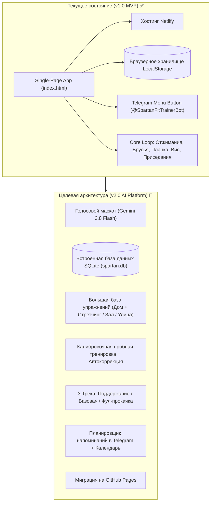
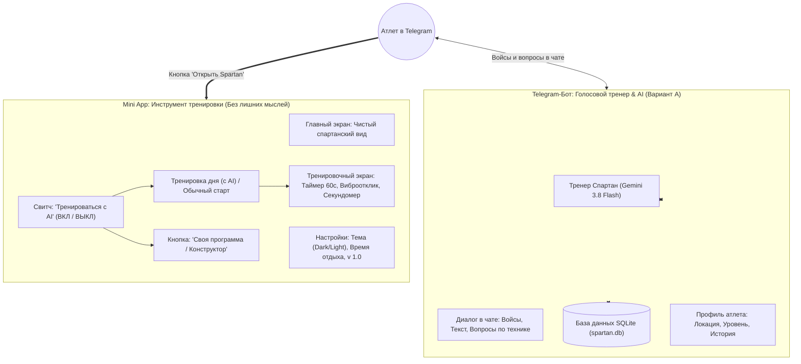
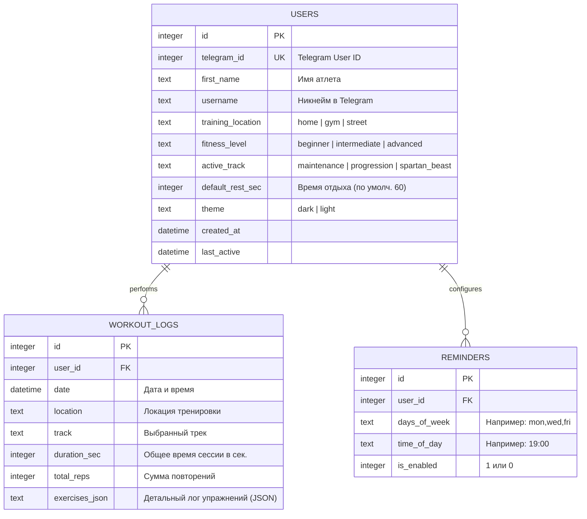

# Архитектура и дорожная карта Spartan Trainer

Документ фиксирует текущее состояние проекта, целевую архитектуру следующей версии (v2.0) и технические спецификации базы данных, AI-маскота и базы упражнений.

---

## 1. Схема развития проекта

---

## 2. Разделение ролей: Telegram-Бот vs Mini App

---

## 3. Схема базы данных SQLite (`spartan.db`)

SQLite — это встроенная легковесная база данных, которая хранится в **одном файле** `spartan.db` рядом с проектом. Она не требует установки внешних СУБД (PostgreSQL/MySQL) и работает в Python «из коробки» через стандартный модуль `sqlite3`.

### Таблицы:

---

## 4. База упражнений по 3 локациям

Каждое упражнение снабжено типом (`reps` — повторения или `time` — статика/секунды), целевой мышечной группой и SVG-контуром (fallback, пока фото не отрисовано).

### 1. Дома (`home`):
* **Базовые**:
  * Отжимания классические (`reps`)
  * Отжимания с широкой постановкой рук (`reps`)
  * Приседания воздушные (`reps`)
  * Выпады на месте (`reps`)
  * Планка на локтях (`time`)
  * Скручивания на пресс (`reps`)
  * Ягодичный мостик (`reps`)
* **Стретчинг & Растяжка (для девушек и гибкости)**:
  * Растяжка «Кошка-Корова» (`time`, 45с)
  * Поза бабочки (раскрытие таза) (`time`, 60с)
  * Наклон к прямым ногам сидя (`time`, 45с)
  * Растяжка квадрицепса стоя (`time`, 30с на ногу)
  * Поза «Собака мордой вниз» (`time`, 45с)
  * «Кобра» / растяжка пресса (`time`, 30с)

### 2. В зале (`gym`):
* **Тренажеры и блочные устройства**:
  * Жим ногами в тренажере (`reps`)
  * Тяга верхнего блока к груди (`reps`)
  * Горизонтальная тяга блока к поясу (`reps`)
  * Сгибание ног лежа в тренажере (`reps`)
  * Разгибание рук на блоке (трицепс) (`reps`)
  * Гиперэкстензия (`reps`)
* **Свободные веса**:
  * Жим гантелей лежа (`reps`)
  * Приседания с гантелями/кубковые (`reps`)
  * Румынская тяга с гантелями (`reps`)

### 3. На улице (`street`):
* **Турники & Брусья (Воркаут)**:
  * Подтягивания средним хватом (`reps`)
  * Подтягивания обратным хватом (`reps`)
  * Отжимания на брусьях (`reps`)
  * Вис на перекладине на время (`time`)
  * Подъемы ног в висе к перекладине (`reps`)
  * Австралийские подтягивания на низком турнике (`reps`)
* **Кардио**:
  * Интервальный бег / Спринт (`time`, 60с)
  * Запрыгивания на скамью / парапет (`reps`)

---

## 5. Голосовой ассистент Спартан в Telegram-боте (Вариант А)

Ассистент живёт в диалоге самого **Telegram-бота** (`bot.py` + `ai_coach.py`):
* **Модель**: `gemini-3.8-flash` (минимальная задержка, лаконичные спартанские ответы).
* **Формат взаимодействия**:
  * Пользователь пишет вопросы текстом или отправляет голосовые сообщения в чат боту.
  * Бот консультирует по технике упражнений, отдыху между сетами и питанию.
  * Проводит первичное интервью и сохраняет профиль в SQLite (`spartan.db`).
  * Отправляет кнопку запуска чистого WebApp для выполнения сессии.

---

## 6. Логика главного экрана WebApp: Свитч «Тренироваться с AI»

Главный экран WebApp остаётся спартански чистым и минималистичным:
1. **Свитч «Тренироваться с AI» ВЫКЛ (Классический режим)**:
   * На экране только большая кнопка: `[ ▶ Начать тренировку ]`.
   * При клике открывается выбор программ: «ОФП Старт», «Турники & Брусья» или «Собрать свою программу».
2. **Свитч «Тренироваться с AI» ВКЛ (Умный режим)**:
   * **В день тренировки**:
     * Большая кнопка: `[ 🔥 Начать: День N (Название) ]`.
     * Под ней аккуратная кнопка: `[ 📋 Своя программа / Конструктор ]`.
   * **В день отдыха / после завершения**:
     * Компактный статус: `«✅ Сегодня цель закрыта. Отдых и суперкомпенсация. Следующая тренировка: Завтра в 19:00»`.
     * Под ним кнопка: `[ 📋 Своя программа / Выбрать упражнения ]`.
3. **Календарь**: вынесен за скобки и не перегружает веб-интерфейс.

---

## 7. Требования к изображениям и оптимизации

Чтобы страницы загружались в Telegram мгновенно даже при 3G/LTE:
* **Формат**: современный **WebP** или прогрессивный **JPEG** с качеством 80–85%.
* **Разрешение**: 
  * Квадратные (1:1): `1024×1024` или `800×800` (вместо исходных 2048×2048).
  * Горизонтальные (16:9): `1280×720`.
  * Вертикальные (9:16): `720×1280`.
* **Целевой вес файла**: **от 50 до 150 КБ** (вместо 1–3 МБ).
* **Fallback**: пока фото рисуется, используется векторный SVG-силуэт упражнения.

---

## 8. План перехода с Netlify на GitHub

1. Инициализация репозитория: `git init`, коммит текущих файлов.
2. Создание репозитория на GitHub (например, `spartan-trainer`).
3. Включение **GitHub Pages**: Settings ➔ Pages ➔ Source: `main` ➔ Save.
4. Адрес приложения станет постоянным: `https://<username>.github.io/spartan-trainer/`.
5. Обновление Menu Button в `@BotFather` через команду `/setmenubutton` на новый GitHub URL.
